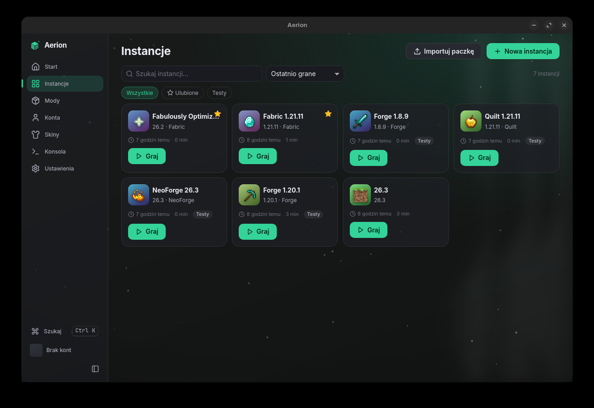
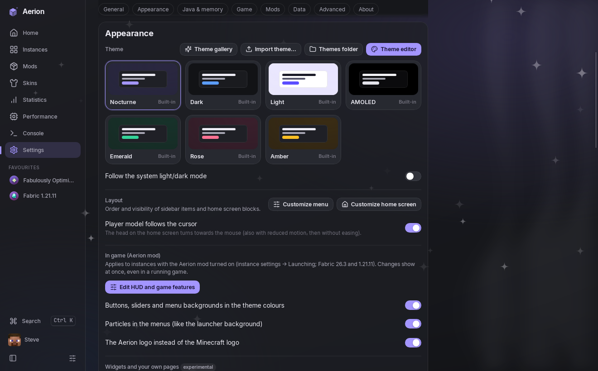
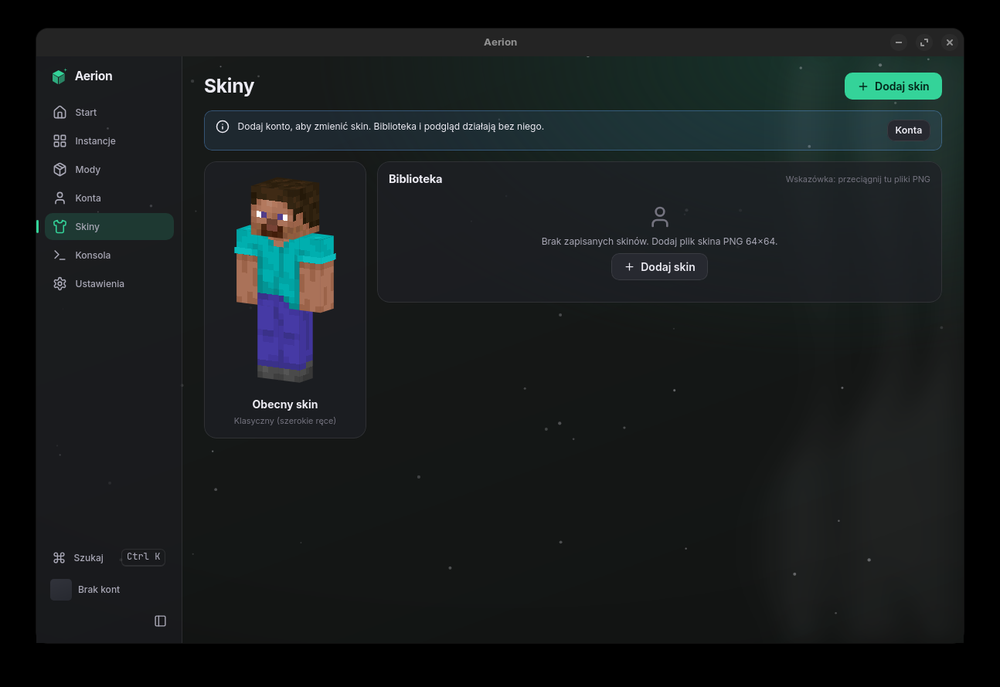

# Aerion

**Aerion** is a fast and **highly customizable** launcher for **Minecraft: Java Edition**
(Windows and Linux). Change its colors, layout, fonts, background (even your own image or video),
particles and icons — all live, without restarting — and take your theme **into the game** with
the Aerion mod. Under the hood it stays light: it opens in under half a second and uses about
180 MB of RAM.

**Highlights:** no data collection · theme editor with live preview · your launcher theme inside Minecraft's menus ·
arrange the sidebar and home screen your way · Minecraft-texture instance icons · Fabric, Quilt,
Forge, NeoForge · Modrinth mods and modpacks · one-click crash fixes · skins and capes ·
automatic updates.

> **Unofficial product.** Aerion is not approved by or associated with Mojang or Microsoft.
> "Minecraft" is a trademark of Mojang Synergies AB.

## Features

- **Microsoft account sign-in** for players who own the game (browser sign-in with PKCE, or a
  code), with silent token refresh.
- **Instances** — separate game folders per version and mod setup, each with its own icon
  (Minecraft item and block textures, or your own picture), **favourites** and groups. Put a
  game folder on another drive, or import instances from other launchers (official launcher,
  Prism/MultiMC, Modrinth App, CurseForge, SKlauncher).
- **Vanilla and mod loaders** — Fabric, Quilt, Forge and NeoForge, installed automatically
  together with the right Java runtime from Mojang. Move an instance to a newer Minecraft
  version with its mods updated for you.
- **Mods, resource packs, shaders and modpacks** from Modrinth (and CurseForge with your own API
  key), with dependency resolution, updates and undo.
- **Worlds, servers and screenshots** of every instance: world backups (also automatic before
  updates), the server list with live status and one-click join, a screenshot gallery.
- **Crash help** — Aerion explains why the game crashed, points at the mod that caused it and
  can **disable it and relaunch in one click**. **Share log** uploads the report to mclo.gs and
  copies a link for your Discord (sign-in tokens and your computer's user name are removed first).
- **Skins** — a local skin library with a 3D preview; wear a skin or choose a cape on your own
  account through the official Minecraft services API. The player on the home screen follows
  your cursor.
- **Statistics** — play time per instance, version and loader, your most used mods.
- **Automatic updates** with a short "What's new" after each one. Polish and English interface.

## Your theme, in the game

Create an instance with **Fabric + Aerion** (or switch the Aerion mod on in any Fabric
instance) and Minecraft's menus follow your launcher theme:

- buttons, sliders and menu backgrounds in your theme's colours,
- the theme's particles (sparkles, dust or snow) behind the menus,
- the Aerion logo on the title screen.

Change the theme in the launcher and a **running game updates within a second**. Each part can be
switched off in *Settings → Appearance → In game*. The mod is built into Aerion, needs no Fabric
API and never touches your mods folder. *Preview: Minecraft 26.3 with Fabric for now.*

## Make it yours

Aerion is built to be customised — almost everything you see can be changed, live, without
restarting:

- **7 built-in themes** (Nocturne, Dark, Light, AMOLED, Emerald, Rose, Amber), a **theme
  gallery** with more, and a **theme editor** with instant preview: every colour, corner
  roundness, density, sidebar or top navigation, UI scale, fonts, glass blur and shadows,
  animation speed.
- **Backgrounds**: solid colour, gradient, **your own image or video**, with dimming and blur,
  soft light ribbons and particle effects (sparkles, dust or snow).
- **Arrange the launcher**: reorder or hide sidebar items and home-screen blocks, put the player
  model left, right or nowhere.
- **Custom CSS** for anything the editor doesn't cover, and themes as plain JSON files — edit
  them in any text editor and the open launcher updates instantly. Export and share themes,
  follow the system's light/dark mode.
- **Simple by default, powerful when you need it**: everyday options up front; JVM arguments,
  Java per version, wrapper commands, environment variables and network settings wait in
  "Advanced" sections — globally and per instance.
- **Accessible by design**: themes are validated so they can't break the launcher, animations
  stop when the system asks for reduced motion, and UI scale/font size help low-vision users.

## Accounts, privacy and security

- **Aerion collects no information about you.** No telemetry, no analytics, no tracking, no
  Aerion account. Your statistics, settings and libraries stay on your computer. The launcher
  only talks to the services needed for what you do: Microsoft and Mojang (sign-in, game files),
  Fabric/Quilt/Forge/NeoForge (loaders), Modrinth or CurseForge (when you browse mods), Adoptium
  (Java when Mojang has none for your system), GitHub (update check, theme gallery) and mclo.gs
  (only when you share a log). Minecraft itself has its own telemetry, which Mojang controls.
- Sign-in uses Microsoft's official OAuth flow (scopes `XboxLive.signin offline_access`) and the
  official Minecraft services. Aerion verifies game ownership and **does not offer any way to
  bypass licensing**; offline play is only available after a licensed account was added.
- There is **no Aerion server**: tokens are kept only in the operating system's credential store
  (Windows Credential Manager, macOS Keychain, Secret Service on Linux), never in plain files,
  and are never sent anywhere except Microsoft and Mojang. Logs are shared only when you click
  "Share log" and confirm.
- Updates are signed and verified before they are installed.
- All game files, including the textures used for icons, are downloaded from Mojang's servers
  at run time; no Minecraft assets are redistributed.

## Download

Get the latest version from [Releases](https://github.com/0giel/Aerion/releases/latest):
`Aerion_x.y.z_x64-setup.exe` for Windows, `.AppImage` or `.deb` for Linux. Installed copies
update themselves.

## Status

In active development by a single developer. The source code is not public at this time.
