<p align="center">
  <picture>
    <source media="(prefers-color-scheme: dark)" srcset="docs/brand/logo-light-text.png">
    
  </picture>
</p>

# Aerion

**Aerion** is a fast and **highly customizable** launcher for **Minecraft: Java Edition**
(Windows and Linux), with its own in-game mod: a full HUD you arrange with the mouse, dozens of
settings for every module, and your launcher theme inside Minecraft's menus.

**Highlights:** no data collection · 24 HUD modules and elements, each with its own look ·
drag-and-resize HUD layout · hitboxes, sound editor, overlays, crosshair, waypoints ·
theme editor with live preview · Fabric, Quilt, Forge, NeoForge · Modrinth mods and modpacks ·
one-click crash fixes · automatic updates.

> **Unofficial product.** Aerion is not approved by or associated with Mojang or Microsoft.
> "Minecraft" is a trademark of Mojang Synergies AB.

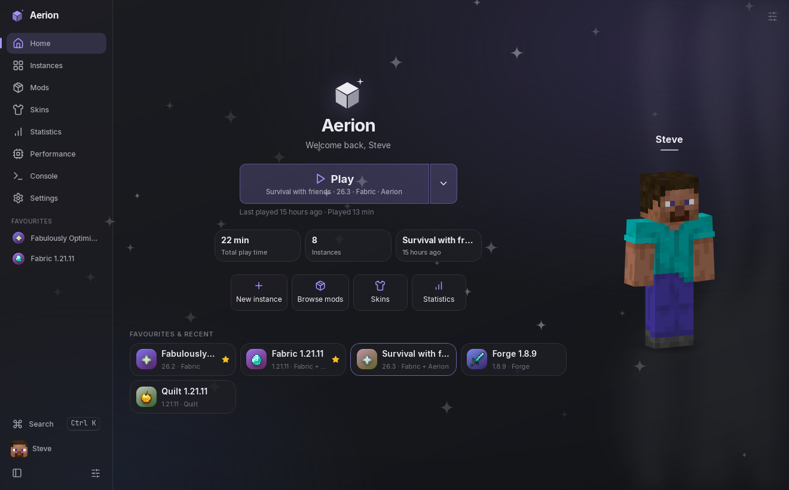

## New in 1.0.0

- **HUD profiles:** separate layouts for PvP, building or survival, switched with a key or by
  themselves when you join a server you assigned to a profile.
- **In-game map** (M): click to add a waypoint; a death point, Nether/Overworld positions,
  sharing a point in chat.
- **Key editor** in the game with a keyboard that shows conflicts, and a shared one in the launcher.
- **Friends** with skin faces and a *Join* button for worlds hosted through e4mc.
- **Screenshot gallery** of every instance, **after-game performance summary**, and moving all
  settings to another computer in one file.
- **Badges** next to names in the game, for example for players who report bugs.
- The mod **updates itself** between launcher releases, and launcher updates download in the
  background.

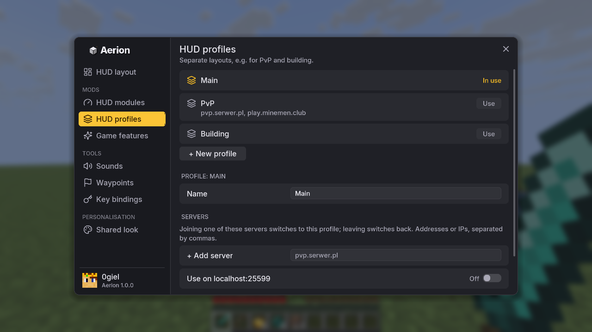

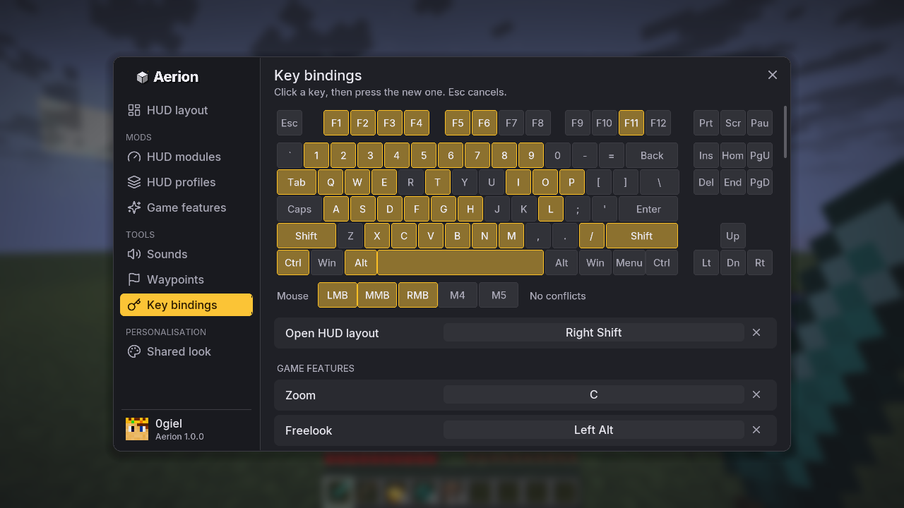

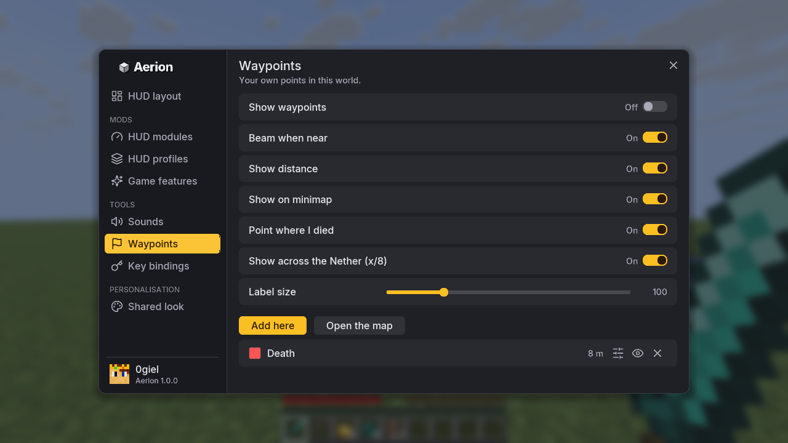

## The Aerion mod

Create an instance with **Fabric + Aerion**, or switch the mod on in any Fabric instance. It works
on **Minecraft 26.3 and 1.21.11**, needs no Fabric API and never touches your mods folder.

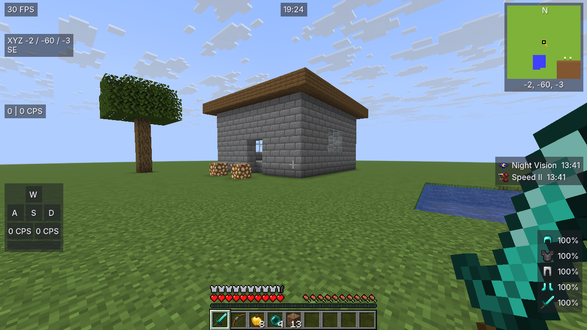

### Arrange your HUD

Press **Right Shift** in the game, or the **Aerion** button in the menu.

- Drag a module anywhere. It snaps to the screen and other modules, with guides.
- Pull a square on any corner to resize it, or nudge it with the arrow keys.
- Undo a change or reset the layout.
- The world stays as you see it in play, so you can judge the layout against the real picture.

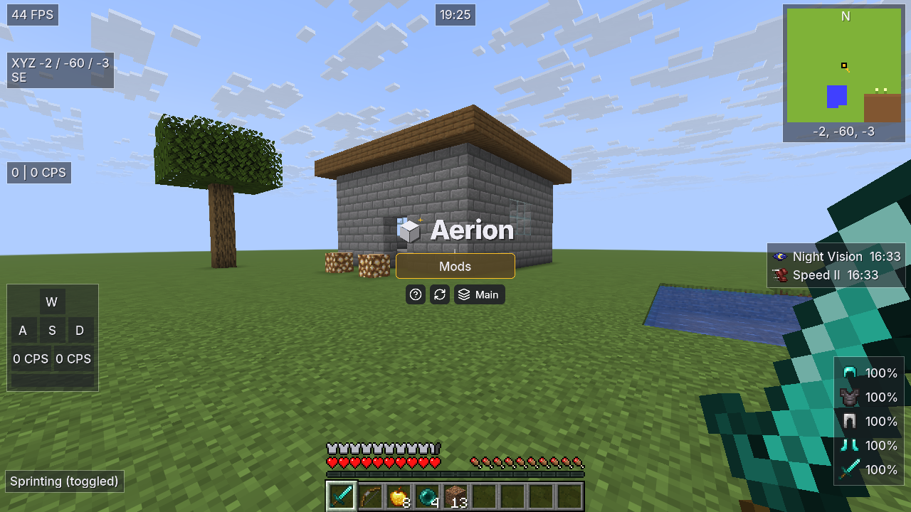

### Modules

FPS, CPS, coordinates, direction, speed, ping, clock, session time, world day, light level, memory,
armor, armor warning, totem counter, item counter, potion effects with their icons, death position,
keystrokes, minimap, resource pack and active toggles. The game's own **boss bar, scoreboard and chat**
can be moved, resized or hidden too.


### Make every module your own

Each module has its own options, a key to turn it on or off, and its own look, or the look they all
share:

- text color, background and its opacity, border and its thickness, corners, padding, alignment,
- smooth text or Minecraft's font,
- a full color picker with color codes, and **chroma**, a color that keeps moving, with its own
  speed and a wave across letters.

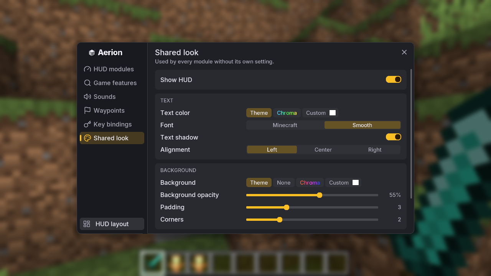

### Game features

Each is switched on separately, and none needs a box on your screen.

- **Hitboxes** in your colors, with another color when a target is in hit range
- **Sound editor:** a volume for every sound in the game, with search and a list of what you just heard
- **Overlays:** lower or fade the fire, remove the pumpkin view, totem animation, vignette and
  other effects, add a screen tint and red edges at low health
- **Crosshair:** your own shape, size and colors
- **Block outline:** color, thickness, fill
- **Waypoints** with a name, color and distance, also on the minimap
- **Light numbers** on the floor around you
- **Hurt cam** strength, **zoom**, **freelook**, **fullbright**, **perspective** and **FOV** keys,
  toggle sprint and sneak
- **Chat:** times, counted repeats, history after disconnecting, opacity
- **Time and weather** that only you see, and the **color of hits**
- **Screen background:** remove the tint and blur behind the inventory and menus

The minimap shows terrain only, and there is no player radar or anything that shows players or mobs
through walls. Some servers forbid extras like freelook, fullbright, hitbox colors or removed
overlays, so check a server's rules first. Those features are off by default.

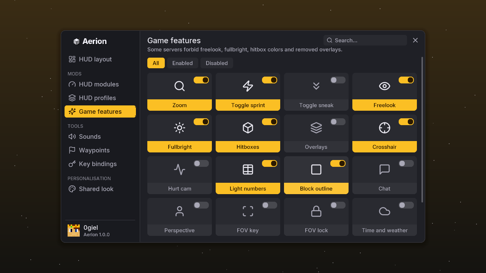

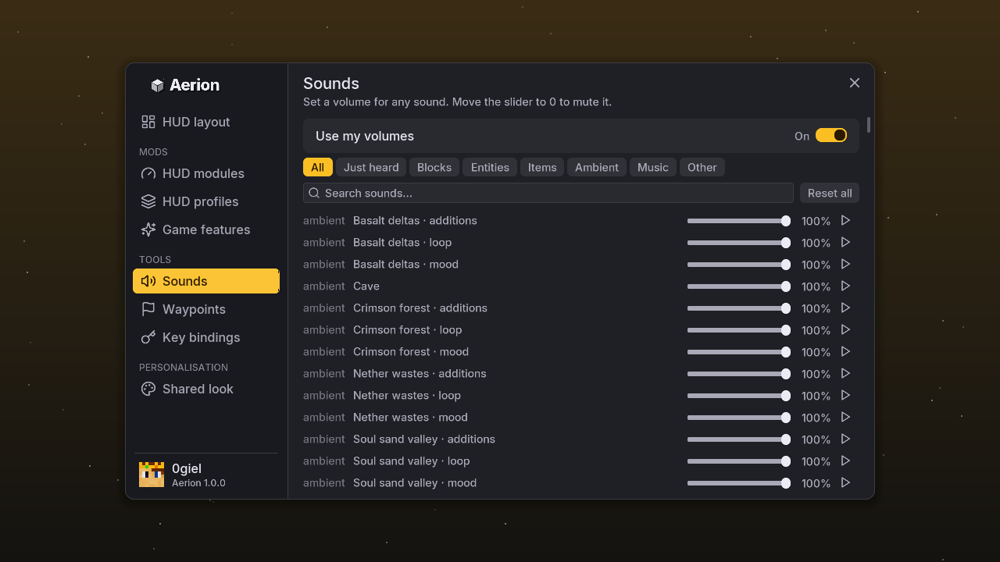

### Your theme, in the game

Minecraft's buttons, sliders and menu backgrounds follow your launcher theme, sharp at every scale,
with the theme's particles and the Aerion logo. Change the theme or any HUD setting in the launcher
and a **running game updates within a second**. Each part can be switched off.

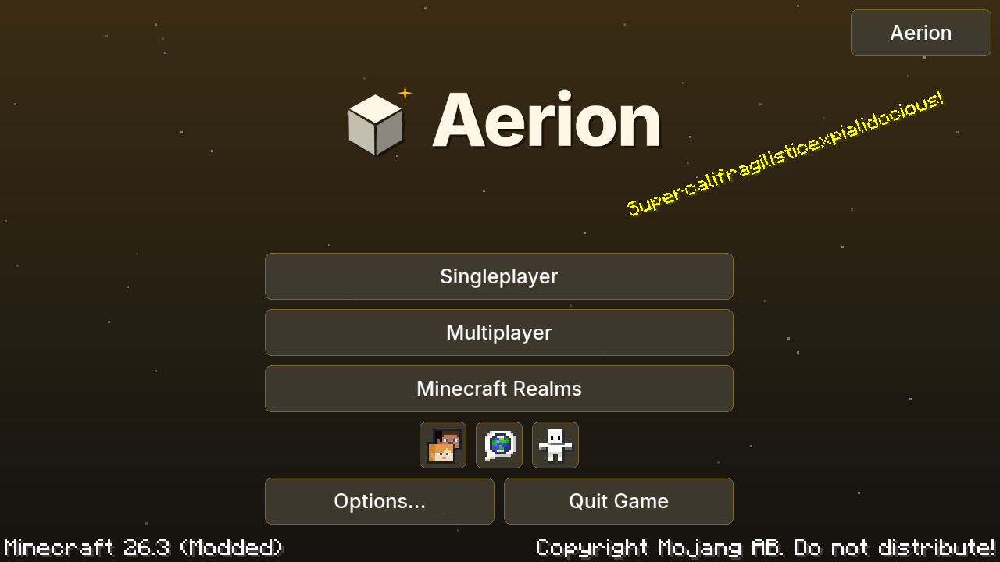

The launcher can edit the HUD as well:

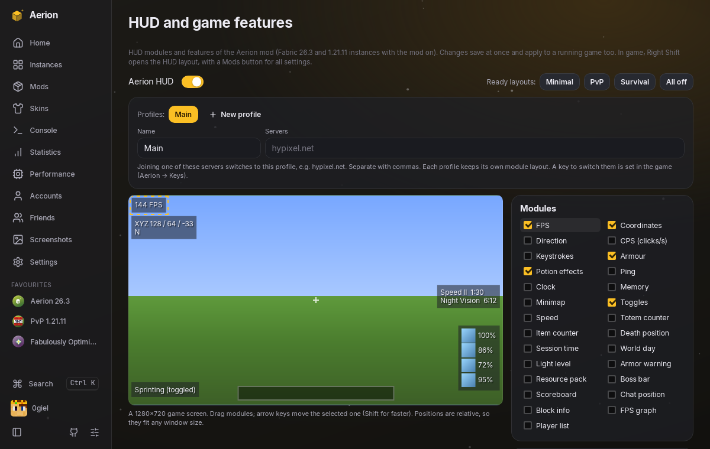

## The launcher

- **Microsoft account sign-in** for players who own the game, with silent token refresh.
- **Instances:** separate game folders per version and mod setup, each with its own icon,
  favourites and groups. Import from other launchers, put a game folder on another drive, or choose
  a world to enter right after start.
- **Vanilla and mod loaders:** Fabric, Quilt, Forge and NeoForge, installed automatically with the
  right Java from Mojang. Move an instance to a newer Minecraft version with its mods updated.
- **Mods, resource packs, shaders and modpacks** from Modrinth (and CurseForge with your own API key).
- **Mod manager:** a check before launch for duplicates, missing dependencies and conflicts, update
  checks in the background, any older version on demand, replacement suggestions.
- **Worlds, servers and screenshots:** world backups, a server list with live status, a gallery.
- **Crash help:** Aerion explains the crash, points at the mod behind it and can **disable it and
  relaunch in one click**. **Share log** uploads a report to mclo.gs for your Discord, with sign-in
  tokens and your computer's user name removed first.
- **Skins:** a local library with a 3D preview; wear a skin or choose a cape on your account.
- **Performance page:** live processor, memory, graphics card and game FPS, measured on your computer.
- **Statistics**, **automatic updates** with a short "What's new", Polish and English.
- **Experimental:** build your home screen and your own pages from widgets.

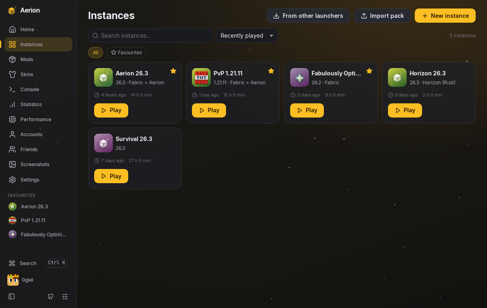

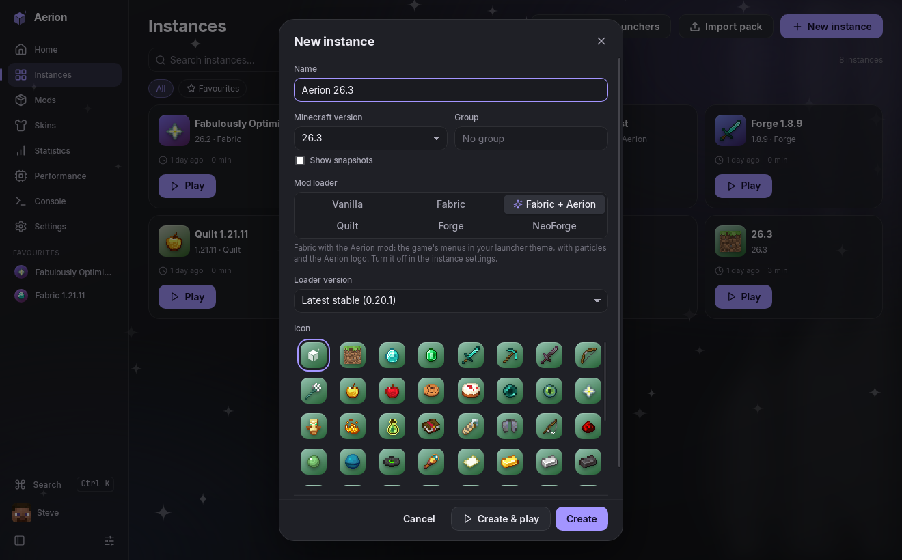

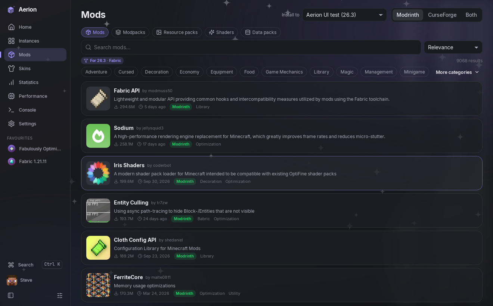

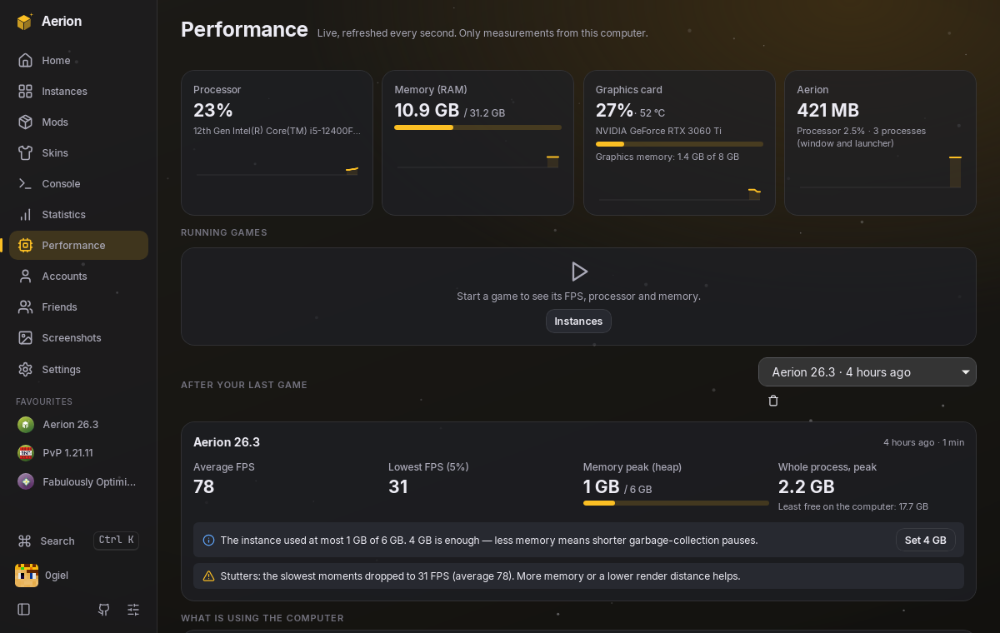

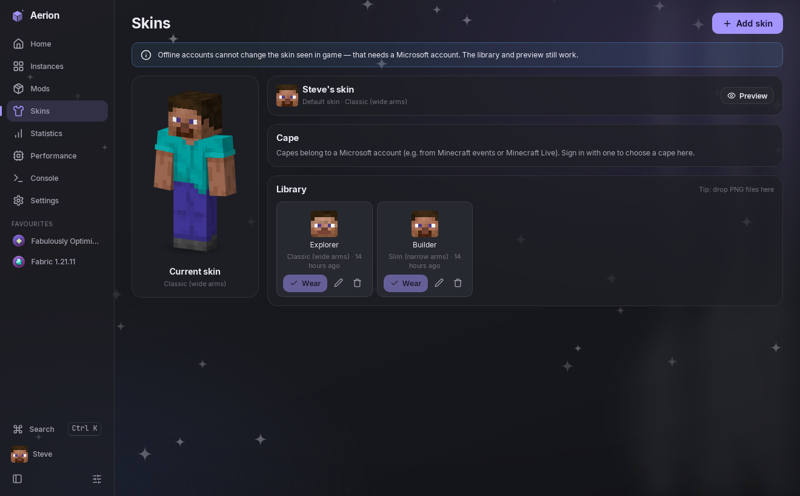

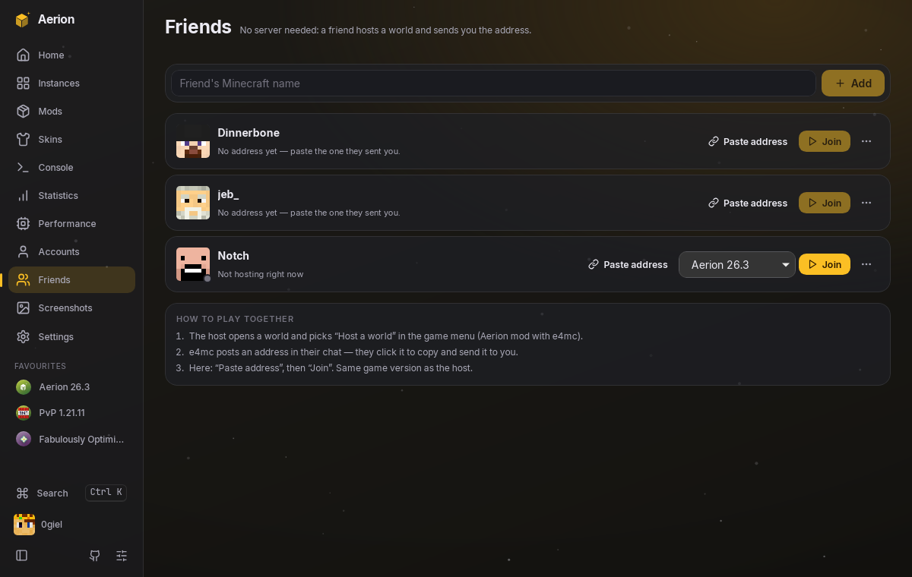

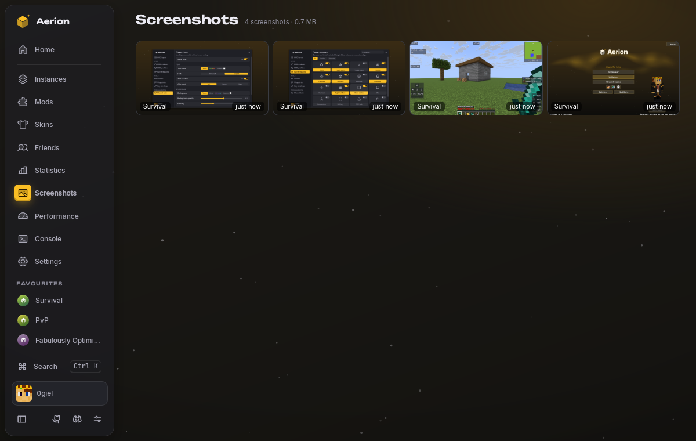

## Make the launcher yours

- **7 built-in themes**, a **theme gallery** and a **theme editor** with instant preview: colors,
  corners, density, sidebar or top navigation, UI scale, fonts, blur and shadows, animation speed.
- **Backgrounds:** solid color, gradient, **your own image or video**, particles.
- **Arrange the launcher:** reorder or hide sidebar items and home-screen blocks.
- **Custom CSS** and themes as plain JSON files, updated live.
- **Simple by default:** everyday options up front, JVM arguments and the like in "Advanced".

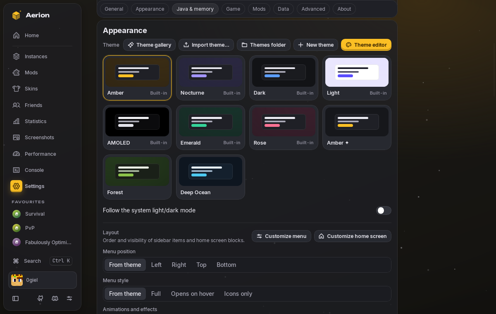

## Accounts, privacy and security

- **Aerion collects no information about you.** No telemetry, no analytics, no tracking, no Aerion
  account. Your statistics, settings and libraries stay on your computer. The launcher only talks to
  the services needed for what you do: Microsoft and Mojang (sign-in, game files),
  Fabric/Quilt/Forge/NeoForge (loaders), Modrinth or CurseForge (when you browse mods), Adoptium (Java
  when Mojang has none for your system), GitHub (updates of the launcher and the mod, theme gallery, badges) and mclo.gs (only when
  you share a log). Minecraft itself has its own telemetry, which Mojang controls.
- Sign-in uses Microsoft's official OAuth flow and the official Minecraft services. Aerion verifies
  game ownership and **does not offer any way to bypass licensing**; offline play is only available
  after a licensed account was added.
- There is **no Aerion server**: tokens are kept only in the operating system's credential store and
  are never sent anywhere except Microsoft and Mojang.
- Updates are signed and verified before they are installed.
- All game files are downloaded from Mojang's servers at run time; no Minecraft assets are
  redistributed.

## Download

Get the latest version from [Releases](https://github.com/0giel/Aerion/releases/latest):
`Aerion_x.y.z_x64-setup.exe` for Windows, `.AppImage` or `.deb` for Linux. Installed copies update
themselves. The Windows installer isn't signed by Microsoft yet, so SmartScreen may warn you: choose
"More info", then "Run anyway".

## Status

Version 1.0.0, made by one person and open source under the GPL-3.0. Microsoft sign-in is approved
by Mojang. Bug reports and ideas are welcome in [issues](https://github.com/0giel/Aerion/issues).

## Building from source

### Before first use

1. **Microsoft sign-in** works out of the box in the released installers. A build from source needs
   its own Azure application approved by Mojang — [docs/AZURE_SETUP.md](docs/AZURE_SETUP.md) — and
   never another launcher's client ID. Without one, everything except signing in works.
2. **CurseForge** (optional) needs a personal API key from <https://console.curseforge.com>,
   entered in *Settings → Mods* (stored in the OS keyring) or as `CURSEFORGE_API_KEY`.
   Modrinth needs nothing.

### Build and run

Requirements: Rust ≥ 1.88 (`rustup`), Node.js ≥ 22 and pnpm; on Linux the WebKitGTK 4.1 stack:

```sh
sudo apt install libwebkit2gtk-4.1-dev libayatana-appindicator3-dev librsvg2-dev libxdo-dev libssl-dev
```

```sh
pnpm install
pnpm tauri dev      # development, hot reload
pnpm tauri build    # release build + installers (NSIS/MSI, deb/AppImage, dmg) in target/release/bundle
```

Without root on Linux, `scripts/linux-devroot.sh` unpacks the `-dev` packages into a private
prefix and `source scripts/env.sh` points the build at it (see [CONTRIBUTING.md](CONTRIBUTING.md)).

### Configuration

| Variable | Effect |
|----------|--------|
| `LAUNCHER_MSA_CLIENT_ID` | Azure client ID (run time, or build time for distributed builds) |
| `CURSEFORGE_API_KEY` | CurseForge key (otherwise entered in Settings) |
| `AERION_UA_AUTHOR`, `AERION_UA_CONTACT` | Build time: identity in the Modrinth `User-Agent` (`author/aerion/version (contact)`) |
| `AERION_HOME` | Put all launcher data in this folder (old name `LUNCHER_HOME` also accepted) |
| `LAUNCHER_DEV_OFFLINE=1` | Debug builds only: offline accounts without a Microsoft account |

Put them in a `.env` file (never commit it) or set them in the shell.

**Data folder**: Windows `%LOCALAPPDATA%\Aerion`, Linux `~/.local/share/aerion`, macOS
`~/Library/Application Support/Aerion`. **Portable mode**: create an empty file named `portable`
next to the executable — data then lives in `data/` beside it.

### Troubleshooting

- **Linux: blank window.** Aerion works around two known causes automatically: broken fontconfig
  caches (symlinks between cache versions, left by newer Flatpak runtimes) and the NVIDIA DMA-BUF
  renderer. The log says when a workaround is active. To repair the font cache for every app:
  `find ~/.cache/fontconfig -name '*.cache-*' -type l -delete && fc-cache`.
- **Linux + NVIDIA: game crashes in `libnvidia-glcore`.** Aerion sets
  `__GL_THREADED_OPTIMIZATIONS=0` for the game by default; an instance variable overrides it.
- **No sound in very old versions on PipeWire** (1.8.9–1.16.5 ship an old OpenAL); the game runs.
- **"Invalid app registration"** — the Azure app awaits Mojang's approval
  ([docs/AZURE_SETUP.md](docs/AZURE_SETUP.md)).
- Launcher logs: *Settings → Data & storage → Launcher logs*; game logs: *Console* or the
  instance's *Logs* tab.

### Documentation

- [docs/PLAN.md](docs/PLAN.md) — research, architecture, milestones
- [docs/STATUS.md](docs/STATUS.md) — what is verified, running log
- [docs/DECISIONS.md](docs/DECISIONS.md) — design decisions
- [docs/THEMING.md](docs/THEMING.md) — theme format and tokens
- [docs/AZURE_SETUP.md](docs/AZURE_SETUP.md) — Microsoft sign-in setup
- [CONTRIBUTING.md](CONTRIBUTING.md) — commands and conventions for contributors

### Development

| Task | Command |
|------|---------|
| Rust tests / lint | `cargo test --workspace` · `cargo clippy --workspace --all-targets -- -D warnings` · `cargo fmt --all --check` |
| Frontend checks | `pnpm check` · `pnpm lint` · `pnpm test` |
| Regenerate IPC types | `cargo test -p aerion -- --ignored export_bindings` |
| Vanilla smoke test | `cargo run -p launcher-core --example smoke -- 26.3` |

Commits follow [Conventional Commits](https://www.conventionalcommits.org). CI runs on Windows,
Linux and macOS.

Third-party terms: Modrinth API (unique User-Agent), CurseForge 3rd-Party API Terms (no caching,
personal keys, no identity concealment through proxies), Mojang's EULA and brand guidelines.

## License

[GNU General Public License v3.0](LICENSE). Dependencies keep their own licences. Minecraft is a
trademark of Mojang Synergies AB; Aerion contains none of its code or assets.
